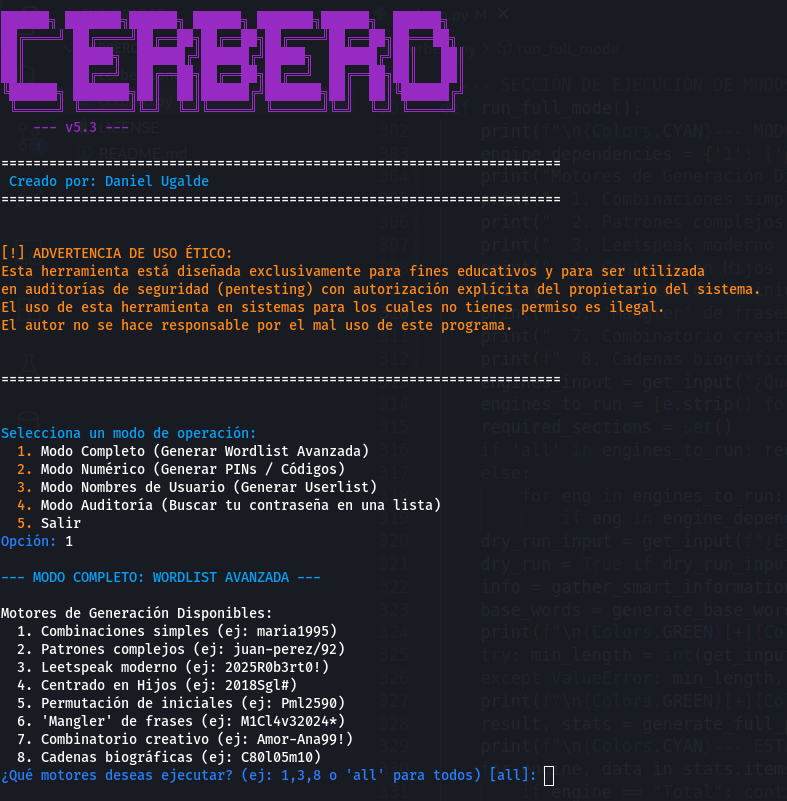

# Cerbero - Suite de Perfilado de Credenciales

<p align="center">
  
</p>

<p align="center">
  <strong>Herramienta de línea de comandos en Python para generar wordlists contextuales de alta precisión para auditorías de seguridad.</strong>
</p>

<p align="center">
  
  
  
</p>

---

**Cerbero** genera listas de nombres de usuario y contraseñas altamente
personalizadas, simulando los patrones que las personas reales usan para crear
sus credenciales. A diferencia de los generadores genéricos, Cerbero usa datos
contextuales (OSINT) para aumentar la efectividad en auditorías de seguridad y
pentesting **ético y autorizado**.

## 🚀 Novedades v8.0

- **📦 Paquete instalable** con comando `cerbero` (instalable con `pipx`).
- **⌨️ CLI con subcomandos**: `generate`, `audit`, `merge`, `init-profile` + menú interactivo.
- **🤖 Headless real** con perfiles de objetivo **YAML/JSON** reutilizables.
- **🔗 Modo `--stdout`** para encadenar directo con **hashcat/john**.
- **🎨 Interfaz Rich** (tablas y paneles) con degradación elegante.
- **🧱 Arquitectura de paquete** (`cerbero/`), pipeline único, logging y tipado.
- **✅ Calidad**: tests, `ruff`, `mypy` y CI en Python 3.9–3.12.

Ver [CHANGELOG.md](CHANGELOG.md) para el detalle completo (incluye correcciones
de bugs del validador de fortaleza, el límite global y el determinismo del Motor 5).

## 🧠 Los 13 motores de generación

| Motor | Descripción | Ejemplo |
| :--- | :--- | :--- |
| **1** | Combinaciones simples (estilo RockYou) | `Juan1982` |
| **2** | Patrones complejos (WiFi/corporativo) | `kasa-tapia/329` |
| **3** | Leetspeak moderno (`Año+NombreLeet`) | `2025Ju4n%` |
| **4** | Centrado en hijos (año e iniciales) | `2012Tpub$` |
| **5** | Permutación de iniciales familiares | `Jtb1772` |
| **6** | "Mangler" de frases con leetspeak | `R3d$S3gura2024!#` |
| **7** | Combinatorio creativo (3+ elementos) | `Juan-Perez1982!` |
| **8** | Cadenas biográficas (`Inicial+Año`) | `T72b96j15` |
| **9** | PRINCE (permutaciones inteligentes) | `juanmaria2024!` |
| **10** | PCFG (gramática probabilística) | `Maria1995#` |
| **11** | Keyboard Walk (patrones de teclado) | `qwe123maria` |
| **12** | ML-Patterns (estructuras frecuentes) | `Juan$95` |
| **13** | Reglas estilo Hashcat (best64 + `.rule` propios) | `Maria2024!`, `m4ri4`, `airam` |

## 🛠️ Instalación

Cerbero requiere Python 3.9 o superior.

```bash
# Opción recomendada: aislado con pipx
pipx install git+https://github.com/syruxst/cerbero.git

# O clásico con pip (idealmente en un entorno virtual)
git clone https://github.com/syruxst/cerbero.git
cd cerbero
pip install .

# Con soporte de Bloom Filter (deduplicación de 100M+ con RAM constante)
pip install ".[bloom]"
```

Esto deja disponible el comando `cerbero`. También puedes ejecutarlo sin
instalar con `python -m cerbero`.

## ⚡ Uso

### Interactivo (por defecto)

```bash
cerbero
```

### Headless con perfil de objetivo

```bash
# 1) Crea una plantilla de perfil y edítala
cerbero init-profile perfil.yaml

# 2) Genera la wordlist
cerbero generate --config perfil.yaml --engines all --output wl.txt

# Solo algunos motores, con límites y rango de longitud
cerbero generate --config perfil.yaml --engines 1,3,8 \
    --min-len 8 --max-len 20 --limit 2000000 --output wl.txt.gz

# Estimar sin escribir
cerbero generate --config perfil.yaml --dry-run

# Motor 13 con tus propias reglas estilo Hashcat (.rule)
cerbero generate --config perfil.yaml --engines 13 --rules best64.rule --output wl.txt
```

El **Motor 13** aplica reglas de transformación (subconjunto de la sintaxis
Hashcat/John: `l u c t r d $X ^X sXY T N` …) a las palabras del contexto. Trae
un conjunto por defecto efectivo y, con `--rules ARCHIVO`, carga cualquier
`.rule` (una regla por línea; `#` para comentarios).

Ejemplo de `perfil.yaml`:

```yaml
persona_principal:
  nombres: [José, Luis]
  apellidos: [Núñez]
  fecha_nacimiento: 1985-07-12   # o 12/07/1985
  sobrenombre: Pepe
pareja:
  nombres: [María]
  fecha_nacimiento: 02/03/1987
hijos:
  - nombres: [Benjamín]
    fecha_nacimiento: 2012-09-01
otros:
  frases: [Red Segura]
  mangle_phrases: [Red Segura]
  numeros_importantes: ["1234"]
```

### Encadenar con hashcat / john (`--stdout`)

Las contraseñas salen por **stdout** y el diagnóstico por **stderr**, así que el
pipe queda limpio:

```bash
cerbero generate --config perfil.yaml --engines all --stdout | hashcat -m 0 hash.txt
cerbero generate --config perfil.yaml --stdout | john --stdin hash.txt
```

### Auditoría defensiva y unión de listas

```bash
# ¿Tu contraseña está en una wordlist? + análisis de fortaleza
cerbero audit --wordlist rockyou.txt --password "MiClave123"

# Unir y deduplicar varias listas
cerbero merge --input-files a.txt,b.txt.gz --output unificada.txt
```

## ⚠️ Advertencia de uso ético

**Cerbero es para uso exclusivo en auditorías de seguridad y pentesting con
autorización explícita del propietario del sistema, o sobre tus propias
credenciales.** El uso no autorizado para acceder a sistemas ajenos es ilegal.
El autor no se responsabiliza por el mal uso de esta herramienta.

## 🤝 Contribuir

```bash
pip install -e ".[dev]"
ruff check cerbero tests
mypy cerbero
pytest
```

PRs bienvenidos: nuevos motores, optimizaciones o correcciones.

## 📄 Licencia

Licencia MIT. Consulta [LICENSE](LICENSE).

## 👤 Autor

Daniel Ugalde - GitHub [@syruxst](https://github.com/syruxst)
